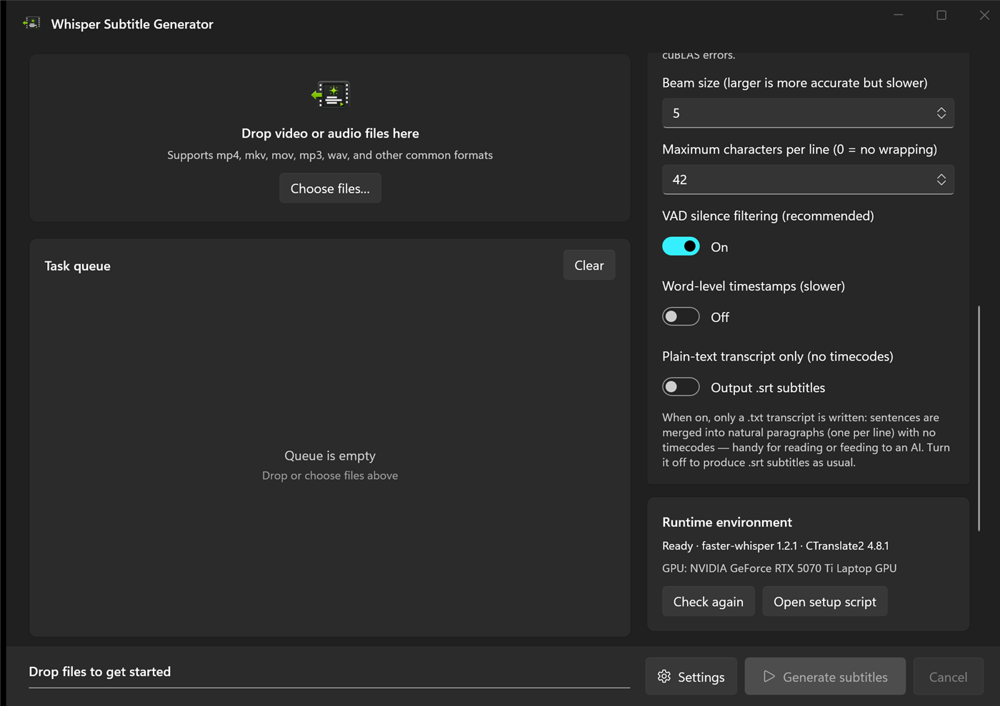
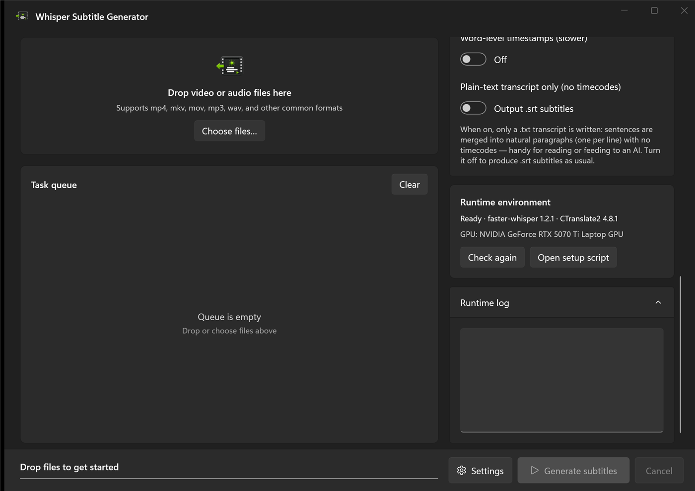

<p align="center">
  
</p>

<h1 align="center">Whisper SRT WinUI</h1>

<p align="center">
  Drag in video or audio, transcribe locally with Whisper, and export SRT subtitles — or a plain-text transcript with <strong>no timecodes</strong>.<br/>
  Native WinUI 3 · faster-whisper (CTranslate2) · no separate ffmpeg needed
</p>

<p align="center">
  
  
  
</p>

<p align="center">
  <a href="README.md">中文</a> · English
</p>

---

<p align="center">
  
</p>

## What is this

A Windows desktop app that drags video/audio in, runs [faster-whisper](https://github.com/SYSTRAN/faster-whisper) on your **local GPU**, and writes out subtitles in batches. Fully offline — nothing is uploaded.

- Audio is decoded by **PyAV (bundled ffmpeg)**, so **no separate ffmpeg install** is required
- Serial queue with live progress: drop in a pile of files and walk away
- Tuned for **RTX 50-series (Blackwell / sm_120)**: `float16` by default, avoiding the INT8 `cuBLAS NOT_SUPPORTED` crash on that architecture
- Chinese / English UI, Mica backdrop with Fluent card layout

## Features

- 🎬 **Drag & drop** — drop files or use “Choose files…”, multi-select, per-job progress and errors
- 📝 **Two output flavours** — `.srt` subtitles with timecodes, or a `.txt` transcript **without any timecodes** (see below)
- 🌍 **Language & task** — pick a language or auto-detect; `translate` turns any language into English
- 🎛️ **Advanced settings** — compute precision, beam size, max chars per line, VAD filtering, word timestamps
- 💻 **GPU or CPU** — falls back to CPU automatically if CUDA init fails (slow, but still usable)
- 📦 **Model manager** — inspect the local cache, pre-download, or delete models you no longer need
- 🧰 **One-click dependencies** — creates the venv and installs the CUDA runtime from inside the app
- 🔔 Output next to the source file or into a custom folder, with a one-click “open” when done

## Two kinds of output

The **Plain-text transcript only (no timecodes)** switch in Advanced settings decides what you get:

<p align="center">
  
</p>

| Switch | Output | Use it for |
|---|---|---|
| Off (default) | `video.srt` | Subtitles for a player |
| On | `video.txt` | Reading, archiving, feeding to an LLM |

How the transcript is laid out:

- Timecodes and indices are dropped; sentences are merged into natural paragraphs at sentence-ending punctuation (`. ! ? 。！？…`), one paragraph per line
- Chinese/Japanese segments are joined without a space; Latin scripts get a single space
- If the model goes a long time without punctuation, paragraphs break at roughly 800 characters so the whole file never collapses into one blob

Real output from the same clip:

```text
# Subtitle mode video.srt
1
00:00:00,000 --> 00:00:11,000
Hello there. This is a test of the
Whisper subtitle generator. It should
also be able to produce a plain text
transcript without any time codes.

2
00:00:11,000 --> 00:00:13,000
Thank you for listening.
```

```text
# Transcript mode video.txt
Hello there. This is a test of the Whisper subtitle generator. It should also be able to produce a plain text transcript without any time codes.
Thank you for listening.
```

## Requirements

| Component | Requirement |
|---|---|
| OS | Windows 11 (Windows 10 works; the Mica backdrop falls back to a solid colour) |
| Front-end build | Visual Studio 2022/2026 with the **.NET desktop** and **Windows App SDK / WinUI** workloads |
| Backend | Python 3.10 – 3.12 (64-bit) on PATH |
| GPU | NVIDIA GPU with a recent driver (RTX 50-series needs CUDA 12.8-capable drivers) |

> No NVIDIA GPU? The backend falls back to CPU — much slower, but it works.

## Getting started

### 1. Set up the backend

Open the `backend` folder and double-click **`setup.bat`**. It creates a `.venv`, installs faster-whisper / CTranslate2 / the CUDA runtime, and runs a GPU self-check. Output like this means the GPU is ready:

```json
{"type": "check", "ok": true, "cuda_device_count": 1, "gpu_name": "NVIDIA GeForce RTX 5070 Ti Laptop GPU", ...}
```

`cuda_device_count` of 1 means CUDA is available; 0 means it will run on CPU, usually a driver or CUDA runtime problem.

You can skip this entirely: start the app and hit **Settings → Install / repair dependencies**, which installs into `%LOCALAPPDATA%\WhisperSubtitler\backend\.venv`.

### 2. Build and run the front end

**Option A: Visual Studio (recommended)** — open `WhisperSubtitler.sln`, pick the **x64** platform, press F5.

**Option B: command line** — WinUI's XAML/MRT targets rely on MSBuild tasks shipped with Visual Studio, so use VS MSBuild (from a VS developer prompt):

```powershell
msbuild WhisperSubtitler.sln /restore /t:Build /p:Configuration=Release /p:Platform=x64
```

> On a machine with only the .NET SDK, `dotnet build` may fail with `MSB4062: Microsoft.Build.Packaging.Pri.Tasks` — that is the SDK missing Visual Studio's AppX packaging tasks, not a code problem. Use VS MSBuild instead.

### 3. Using it

1. Launch the app; once it shows “Ready · faster-whisper …” you are good to go
2. Drop in video/audio files, or use “Choose files…” (multi-select works)
3. Pick a model, language and output location on the right; flip the transcript switch if you want plain text
4. Hit **Generate subtitles**; the first run of a model downloads its weights (`large-v3` is ~3 GB, cached in `%USERPROFILE%\.cache\huggingface`)
5. Each finished job gets an “Open” link that reveals the output in Explorer

## Packaging as MSIX (self-signed sideload)

```powershell
# 1) Build: produces packaging\build\WhisperSubtitler_<version>_x64.msix plus the test cert
.\packaging\build-msix.ps1 -Version 1.0.10.0

# 2) Install: right-click packaging\install-msix.bat -> Run as administrator
#    The script imports packaging\WhisperSubtitler_TestCert.cer into LocalMachine\TrustedPeople, then installs
```

On a machine that already trusts the certificate, no elevation is needed:

```powershell
Add-AppxPackage -Path .\packaging\build\WhisperSubtitler_1.0.10.0_x64.msix -ForceUpdateFromAnyVersion
```

> The new version must be higher than the installed one to update in place; `-ForceUpdateFromAnyVersion` relaxes that.
> A self-signed package only installs on machines that trust the test certificate (its private key stays in the packager's certificate store and is not in this repo).

## Choosing a model (English, 12 GB VRAM)

| Model | English quality | Relative speed | VRAM (float16) | Notes |
|---|---|---|---|---|
| **large-v3** | Best | 1× | ~6 GB | Quality first (default) |
| large-v3-turbo | Very close (-0.3% WER) | ~4× | ~3 GB | When you want speed |
| distil-large-v3.5 | Close to large-v3 (English) | ~2× | ~4 GB | English-only, fast |
| medium | Fair | Faster | ~2 GB | Low VRAM |

The backend also accepts `small` / `base` / `tiny` via the command line (`--model tiny`).

## FAQ

**The status light stays grey / “Python environment not found”.**
Run `backend\setup.bat`, or use **Install / repair dependencies** in Settings. Settings live in `%LOCALAPPDATA%\WhisperSubtitler\settings.json`; `PythonPathOverride` and `BackendScriptOverride` can point at custom locations.

**I get `cuBLAS ... NOT_SUPPORTED` or other INT8 errors.**
A known 50-series incompatibility. Keep **Advanced settings → Compute precision** at `float16` (the default).

**`cuda_device_count` is 0, so it runs on CPU.**
Update the NVIDIA driver to one that supports CUDA 12.8, and make sure `nvidia-cublas-cu12` / `nvidia-cudnn-cu12` from `requirements.txt` are installed (the backend adds their DLL folders to the search path automatically).

**Model downloads are slow.**
Set a mirror before launching the app: `set HF_ENDPOINT=https://hf-mirror.com`, or copy the model into the HuggingFace cache folder manually.

**Installing reports an untrusted certificate.**
Run `packaging\install-msix.bat` once (as administrator) to import the test certificate into LocalMachine\TrustedPeople.

**Build errors about Windows App SDK / runtime.**
Make sure the Windows App SDK workload is installed in VS; this project is configured as self-contained (`WindowsAppSDKSelfContained`), so no separate runtime install is normally needed.

## Project layout

```
Whisper SRT/
├─ WhisperSubtitler.sln
├─ backend/                     Python transcription backend (faster-whisper)
│  ├─ transcribe.py             Main script: --check, or transcribe to SRT/TXT with JSON progress on stdout
│  ├─ requirements.txt          Blackwell-friendly deps (CT2>=4.5, cuDNN9, cuBLAS12)
│  └─ setup.bat                 venv + deps + self-check in one go
├─ src/WhisperSubtitler/        WinUI 3 front end (C#)
│  ├─ MainWindow.xaml(.cs)      UI, file pickers, drag & drop, open output
│  ├─ Models/AppModels.cs       Enums, model/language options, persisted settings
│  ├─ ViewModels/               MainViewModel (orchestration, serial queue, progress), JobItem
│  ├─ Services/
│  │  ├─ BackendLocator.cs      Locates transcribe.py and the venv python
│  │  ├─ BackendRunner.cs       Child process, JSON progress parsing, cancellation
│  │  ├─ BackendInstaller.cs    One-click dependency install
│  │  └─ SettingsService.cs     Settings persisted to %LOCALAPPDATA%
│  ├─ Strings/{zh-CN,en-US}/    UI strings
│  └─ Converters/               XAML value converters
├─ packaging/                   MSIX build/install scripts, tiles, test certificate
└─ docs/                        README screenshots
```

## How it works

```
[video/audio] ──PyAV(ffmpeg) decodes the audio track──▶ faster-whisper(large-v3, float16, CUDA)
        ──▶ per-segment text + timestamps ──▶ write .srt
                                          └─(--format txt) merge into paragraphs ──▶ write timecode-free .txt
```

The WinUI front end runs the backend as a child process and reads progress over a “one JSON object per line” protocol on stdout; diagnostics go to stderr so the protocol stays clean.

The backend also works standalone as a CLI:

```powershell
python transcribe.py --check
python transcribe.py --input video.mp4 --output video.srt --model large-v3 --language en
python transcribe.py --input video.mp4 --output video.txt --format txt --language en
```

## Contributors

- [**@aaronderek**](https://github.com/aaronderek) — author
- **DeepSeek Harness (deepseek-flash)** — AI pairing: timecode-free transcript output, MSIX packaging and release workflow

## License

[MIT](LICENSE)
