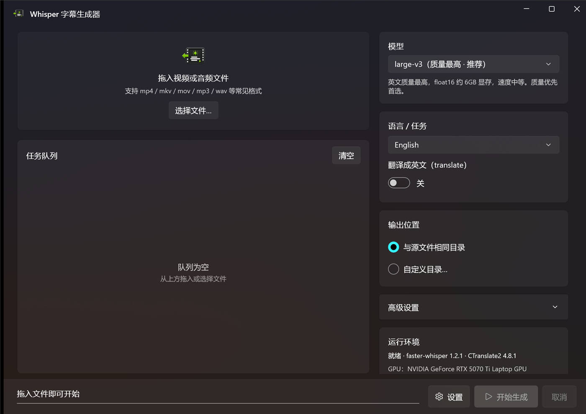
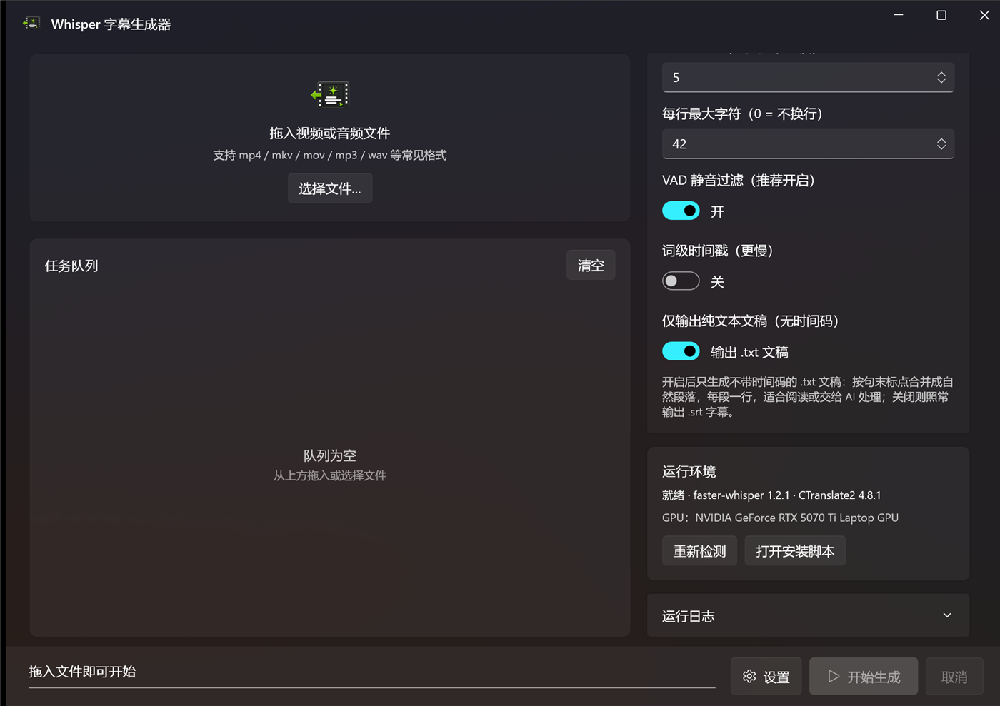

<p align="center">
  
</p>

<h1 align="center">Whisper SRT WinUI</h1>

<p align="center">
  把视频/音频拖进来，本地 Whisper 识别，导出 SRT 字幕 —— 或者一份<strong>没有时间码</strong>的纯文本文稿。<br/>
  原生 WinUI 3 · faster-whisper (CTranslate2) · 免装 ffmpeg
</p>

<p align="center">
  
  
  
</p>

<p align="center">
  中文 · <a href="README.en.md">English</a>
</p>

---

<p align="center">
  
</p>

## 这是什么

一个 Windows 桌面应用：拖入视频或音频，用 [faster-whisper](https://github.com/SYSTRAN/faster-whisper) 在**本机 GPU** 上跑 Whisper，批量产出字幕。全程离线，不上传任何文件。

- 音轨由 **PyAV（内置 ffmpeg）** 直接解码，**不需要单独安装 ffmpeg**
- 串行队列 + 实时进度，批量拖入一堆文件后可以走开
- 针对 **RTX 50 系（Blackwell / sm_120）** 做了适配：默认 `float16`，绕开 INT8 在该架构上触发的 `cuBLAS NOT_SUPPORTED` 崩溃
- 界面中英文双语，Mica 背景 + Fluent 卡片布局

## 功能

- 🎬 **拖拽即用** — 拖入文件或“选择文件…”，支持多选批量排队，逐条显示进度与错误
- 📝 **两种输出** — 带时间码的 `.srt` 字幕，或**不带时间码的 `.txt` 文稿**（见下节）
- 🌍 **语言与任务** — 指定语言或自动检测；`translate` 可把任意语言直接转成英文
- 🎛️ **高级设置** — 计算精度、beam size、每行最大字符、VAD 静音过滤、词级时间戳
- 💻 **GPU / CPU 可选** — CUDA 初始化失败时可自动回退 CPU（慢，但不会完全不可用）
- 📦 **模型管理** — 在设置里查看本地缓存、提前下载、删除不用的模型
- 🧰 **一键安装依赖** — 应用内即可创建 venv 并安装 CUDA 运行库，不用手敲命令
- 🔔 输出位置可选源文件同目录或自定义目录，完成后一键定位文件

## 两种输出

高级设置里的 **仅输出纯文本文稿（无时间码）** 开关决定产物：

<p align="center">
  
</p>

| 开关 | 产物 | 用途 |
|---|---|---|
| 关（默认） | 同名 `.srt` | 挂到播放器上看字幕 |
| 开 | 同名 `.txt` | 阅读、存档、投喂给 AI 做摘要 |

文稿模式的排版规则：

- 去掉时间码与序号，按**句末标点**（`. ! ? 。！？…` 等）合并成自然段落，每段一行
- 中文/日文相邻片段直接相连不插空格；英文等按西文习惯补一个空格
- 万一模型长时间不输出标点，段落会在约 800 字符处兜底断开，避免整篇挤成一段

真实输出对比（同一段音频）：

```text
# 字幕模式 video.srt
1
00:00:00,000 --> 00:00:11,000
Hello there. This is a test of the
Whisper subtitle generator. It should
also be able to produce a plain text
transcript without any time codes.

2
00:00:11,000 --> 00:00:13,000
Thank you for listening.
```

```text
# 文稿模式 video.txt
Hello there. This is a test of the Whisper subtitle generator. It should also be able to produce a plain text transcript without any time codes.
Thank you for listening.
```

## 环境要求

| 组件 | 要求 |
|---|---|
| 操作系统 | Windows 11（Win10 也可运行，Mica 背景会回退为纯色）|
| 前端构建 | Visual Studio 2022/2026（勾选 **.NET 桌面开发** 与 **Windows App SDK / WinUI** 工作负载）|
| 后端 | Python 3.10 – 3.12（64 位），加入 PATH |
| 显卡 | NVIDIA GPU + 最新驱动（RTX 50 系需支持 CUDA 12.8 的驱动）|

> 没有 NVIDIA 显卡也能用，后端会自动走 CPU，只是慢很多。

## 快速开始

### 1. 装后端

打开 `backend` 文件夹，双击 **`setup.bat`**。脚本会自动创建虚拟环境 `.venv` → 安装 faster-whisper / CTranslate2 / CUDA 运行库 → 跑 GPU 自检。看到下面这样的输出就代表 GPU 就绪：

```json
{"type": "check", "ok": true, "cuda_device_count": 1, "gpu_name": "NVIDIA GeForce RTX 5070 Ti Laptop GPU", ...}
```

`cuda_device_count` 为 1 = GPU 可用；为 0 = 会走 CPU，通常是驱动或 CUDA 运行库问题。

也可以完全跳过这一步：启动应用后在 **设置 → 一键安装 / 修复依赖** 里点一下，依赖会装到 `%LOCALAPPDATA%\WhisperSubtitler\backend\.venv`。

### 2. 构建并运行前端

**方式 A：Visual Studio（推荐）** — 打开 `WhisperSubtitler.sln`，平台选 **x64**，按 F5。

**方式 B：命令行** — WinUI 的 XAML/MRT 目标依赖 Visual Studio 提供的 MSBuild 任务，用 VS 的 MSBuild 最稳（在 VS 开发者命令行里）：

```powershell
msbuild WhisperSubtitler.sln /restore /t:Build /p:Configuration=Release /p:Platform=x64
```

> `dotnet build` 在只有 .NET SDK 的机器上可能报 `MSB4062: Microsoft.Build.Packaging.Pri.Tasks` 找不到 —— 那是 SDK 缺少 VS 的 AppX 打包任务，不是代码问题，换用上面的 VS MSBuild 即可。

### 3. 使用

1. 启动应用，右上角显示 “就绪 · faster-whisper …” 即可用
2. 拖入视频/音频，或点“选择文件…”（支持多选）
3. 右侧选模型、语言、输出位置；需要文稿就打开高级设置里的开关
4. 点 **开始生成**；首次使用某个模型会自动下载权重（`large-v3` 约 3 GB，缓存在 `%USERPROFILE%\.cache\huggingface`）
5. 完成后每条任务出现“打开”，直接在资源管理器里定位产物

## 打包成 MSIX（自签名 sideload）

```powershell
# 1) 打包：产出 packaging\build\WhisperSubtitler_<版本>_x64.msix 与测试证书
.\packaging\build-msix.ps1 -Version 1.0.10.0

# 2) 安装：右键 packaging\install-msix.bat -> 以管理员身份运行
#    脚本会把 packaging\WhisperSubtitler_TestCert.cer 导入「本地计算机\受信任人」后安装
```

证书已在受信任人里的机器上，也可以不提权直接装：

```powershell
Add-AppxPackage -Path .\packaging\build\WhisperSubtitler_1.0.10.0_x64.msix -ForceUpdateFromAnyVersion
```

> 新版本号必须高于已安装版本才能覆盖升级；`-ForceUpdateFromAnyVersion` 可以放宽这条限制。
> 自签名包只能装到信任该测试证书的机器上（证书私钥保存在打包者的证书存储里，不进仓库）。

## 模型怎么选（英文，12 GB 显存）

| 模型 | 英文质量 | 相对速度 | float16 显存 | 建议 |
|---|---|---|---|---|
| **large-v3** | 最高 | 1× | ~6 GB | 质量优先（默认）|
| large-v3-turbo | 极接近（-0.3% WER）| ~4× | ~3 GB | 想更快 |
| distil-large-v3.5 | 接近 large-v3（英文）| ~2× | ~4 GB | 纯英文、要快 |
| medium | 一般 | 更快 | ~2 GB | 省显存 |

后端还内置 `small` / `base` / `tiny`，可直接用命令行 `--model tiny` 指定。

## 常见问题

**Q：右上角一直是灰灯 / 提示“未找到 Python 环境”。**
先跑 `backend\setup.bat`，或用设置里的「一键安装 / 修复依赖」。设置文件在 `%LOCALAPPDATA%\WhisperSubtitler\settings.json`，可用 `PythonPathOverride` / `BackendScriptOverride` 指定路径。

**Q：报 `cuBLAS ... NOT_SUPPORTED` 或 INT8 相关错误。**
这是 50 系对 INT8 的已知不兼容。把「高级设置 → 计算精度」保持为 **float16**（默认值）。

**Q：`cuda_device_count` 为 0，走了 CPU。**
更新 NVIDIA 驱动到支持 CUDA 12.8 的版本；确认 `requirements.txt` 里的 `nvidia-cublas-cu12` / `nvidia-cudnn-cu12` 装上了（后端会自动把它们加入 DLL 搜索路径）。

**Q：模型下载太慢。**
先设镜像再启动应用：`set HF_ENDPOINT=https://hf-mirror.com`，或手动把模型放进 HuggingFace 缓存目录。

**Q：安装时报证书不受信任。**
先运行一次 `packaging\install-msix.bat`（管理员），它会把测试证书导入「本地计算机\受信任人」。

**Q：构建报 Windows App SDK / 运行时相关错误。**
确认 VS 装了 Windows App SDK 工作负载；本工程已配置为自包含（`WindowsAppSDKSelfContained`），一般无需单独安装运行时。

## 项目结构

```
Whisper SRT/
├─ WhisperSubtitler.sln
├─ backend/                     Python 转录后端（faster-whisper）
│  ├─ transcribe.py             主脚本：--check 自检 / 转录并输出 SRT 或 TXT，stdout 发 JSON 进度
│  ├─ requirements.txt          Blackwell 兼容依赖（CT2>=4.5, cuDNN9, cuBLAS12）
│  └─ setup.bat                 一键建 venv + 装依赖 + 自检
├─ src/WhisperSubtitler/        WinUI 3 前端（C#）
│  ├─ MainWindow.xaml(.cs)      界面 + 文件选择/拖放/打开输出
│  ├─ Models/AppModels.cs       枚举、模型/语言项、可持久化设置
│  ├─ ViewModels/               MainViewModel（编排、串行队列、进度）、JobItem
│  ├─ Services/
│  │  ├─ BackendLocator.cs      自动定位 transcribe.py 与 venv python
│  │  ├─ BackendRunner.cs       启动子进程、解析 JSON 进度、取消
│  │  ├─ BackendInstaller.cs    一键安装依赖
│  │  └─ SettingsService.cs     设置持久化到 %LOCALAPPDATA%
│  ├─ Strings/{zh-CN,en-US}/    中英文界面文案
│  └─ Converters/               XAML 值转换器
├─ packaging/                   MSIX 打包与安装脚本、图标、测试证书
└─ docs/                        README 截图
```

## 工作原理

```
[视频/音频] ──PyAV(ffmpeg)解码音轨──▶ faster-whisper(large-v3, float16, CUDA)
        ──▶ 逐段字幕 + 时间戳 ──▶ 写出 .srt
                            └─（--format txt）按标点合并成段落 ──▶ 写出无时间码的 .txt
```

前端（WinUI）以子进程方式调用后端，通过 stdout 上的「每行一个 JSON」协议实时接收进度与完成信号；
诊断信息走 stderr，不会污染协议。

后端也可以单独当命令行工具用：

```powershell
python transcribe.py --check
python transcribe.py --input video.mp4 --output video.srt --model large-v3 --language en
python transcribe.py --input video.mp4 --output video.txt --format txt --language en
```

## Contributors

- [**@aaronderek**](https://github.com/aaronderek) — 作者
- **DeepSeek Harness (deepseek-flash)** — AI 结对：无时间码文稿输出、MSIX 打包与发布流程

## License

[MIT](LICENSE)
